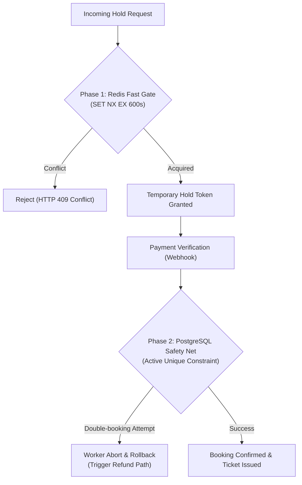

# Rule 02: Inventory, Seat Holds & Concurrency Control

**Applies to:** `apps/server/src/services/hold*`, `apps/server/src/services/booking*`, Prisma schema, Redis lock scripts  
**Severity:** CRITICAL / NON-NEGOTIABLE

---

## 1. The Core Engineering Invariant

> **One seat can have at most ONE confirmed booking for a given showtime.**
> Under extreme concurrency, race conditions, server restarts, or partial outages, duplicate active seat allocations must be physically impossible.

---

## 2. The Two-Phase Gate Architecture

Inventory protection relies on two coordinated gates:

### Phase 1: Fast Redis Gate (Temporary Holds)
1. **Hold Duration:** A hold expires after **exactly 10 minutes (600 seconds)**. The server expiry timestamp is authoritative; client countdown timers are purely cosmetic.
2. **Atomic Multi-Seat Evaluation:**
   - Multi-seat holds must be **all-or-nothing** from the user's perspective.
   - You must use an atomic Redis Lua script (or an atomic transactional multi-key lock with safe compensating release).
   - If even one seat in the requested list is already held or booked, **none** of the requested seats may be locked. Any keys acquired during that request must be released using compare-and-delete token checks.
3. **Namespacing & Token Ownership:**
   - Redis hold keys must follow the strict namespace: `showtime:{showtimeId}:seat:{seatId}:hold`.
   - The value stored must be a unique, cryptographically random `holdToken` tied to the user session.
   - Never release a Redis hold unless the existing value matches the caller's `holdToken`.

### Phase 2: PostgreSQL Durable Safety Net (Confirmed Allocations)
1. **Durable Source of Truth:** PostgreSQL is the only authoritative source of truth for confirmed bookings and seat allocations.
2. **Active Allocation Unique Constraint:**
   - Database constraints must prevent two active allocations for the same `(showtime_id, seat_id)`.
   - Implement this via a partial unique index on the allocation table (e.g., `WHERE status IN ('HELD', 'CONFIRMED')`) or explicit active allocation table constraint.
   - Document the status/cancellation lifecycle. Do not create a blanket constraint that prevents a seat from ever being booked in future showtimes or after legitimate cancellation.
3. **Transactional Confirmation:**
   - Confirmation must run inside a strict PostgreSQL database transaction (`prisma.$transaction`).
   - The transaction must lock the showtime inventory, verify seat availability, and insert the active allocation record.
   - If the database unique constraint is violated, the transaction must roll back, fail safely, and trigger the refund compensation path.

---

## 3. Concurrency Invariants & Prohibitions

1. **Never Trust Cached Seat-Map State:** The cached seat-map is a short-lived view (snapshot). Never approve a hold or confirm a booking based on cached state without atomic validation against the real-time store.
2. **Redis Outage Safety & Database Fallback:**
   - If Redis is down, return HTTP `503 Service Unavailable` with `Retry-After: 30`, **UNLESS** an explicitly designed database-only fallback providing equivalent transactional guarantees (e.g. `SELECT ... FOR UPDATE` row locks inside a transaction) is actively implemented.
   - Under no circumstances should inventory locks be bypassed or assumed successful during a Redis outage without atomic protection.
3. **Reconciliation Job is Not Primary Correctness:** Background cleanup of expired holds is an asynchronous garbage collector, not the primary mechanism that prevents double-booking. Correctness must hold even if the cleanup worker is delayed.
4. **Late Payment Compensation:** If payment completes after the 10-minute hold has expired and the seat was subsequently acquired by another user:
   - **NEVER** overwrite the new occupant's allocation.
   - Safely allocate if the seat is still free.
   - If the seat is taken, log the exception, insert an append-only refund entry, and alert customer support.

