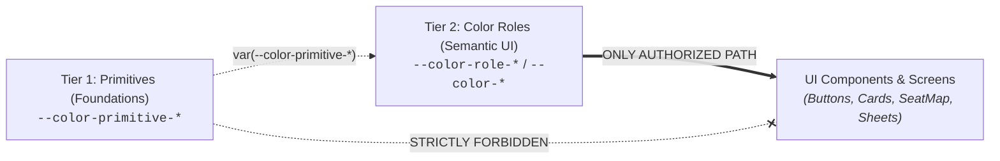

# Rule 06: Design System, UI Tokens & Mobile Accessibility

**Applies to:** `apps/mobile/src/components/`, `apps/mobile/src/screens/`, theme styles, design tokens  
**Severity:** HIGH / NON-NEGOTIABLE

---

## 1. The Two-Tier Color Architecture

The Lead Row design system separates **Foundations** from **Semantic Application**:

### Strict Color Rules:
1. **Never Apply Primitives to UI:** Token variables prefixed with `--color-primitive-*` are raw palette ramps. They must **never** appear in component stylesheets, JSX style props, or screen templates.
2. **Exclusively Consume Color Roles:** All UI elements must bind strictly to semantic color roles (`--color-role-*` or convenience alias `--color-*`), e.g.:
   - Primary interactive surfaces: `var(--color-role-primary)` / `var(--color-primary)`
   - Text on primary: `var(--color-role-on-primary)` / `var(--color-on-primary)`
   - Page & card background: `var(--color-role-surface)` / `var(--color-surface)`
   - High-emphasis text: `var(--color-role-on-surface)` / `var(--color-on-surface)`
   - Dividers & borders: `var(--color-role-outline)` / `var(--color-outline)`
   - Error states & destructive buttons: `var(--color-role-error)` / `var(--color-error)`

---

## 2. Spacing, Typography & Elevation Grid

1. **4pt / 8pt Spacing Rhythm:** All margins, paddings, and layout gaps must use standardized tokens in 4/8pt multiples:
   - `--spacing-xxs` (2px), `--spacing-xs` (4px), `--spacing-sm` (8px), `--spacing-md` (10px), `--spacing-base` (16px), `--spacing-lg` (20px), `--spacing-xl` (24px), `--spacing-2xl` (32px), `--spacing-layout-1` (48px), `--spacing-layout-2` (64px).
   - Arbitrary one-off spacing values (e.g. `margin: 13px`, `padding: 19px`) are forbidden.
2. **Typography Pairing:**
   - **Playfair Display:** Reserved for high-impact, editorial titles (`display-large`, `display-medium`, `display-small`).
   - **Inter:** Used for all functional, readable UI text (`headline-*`, `title-*`, `body-*`, `label-*`).
3. **Elevation:** Depth must be expressed through tokens: `--shadow-soft` (cards), `--shadow-medium` (hover/active), and `--shadow-hard` (bottom sheets and modals).

---

## 3. Accessibility & Usability Standards (WCAG AA)

1. **Minimum Touch Targets:** Every interactive element (buttons, seat tiles, close icons, chips) must have an active touch area of **at least 44 × 44 points**.
2. **Color Contrast:** Normal text must maintain at least **4.5:1** contrast against its background; large text and interactive boundaries must maintain at least **3:1** contrast.
3. **Screen Readers:**
   - Interactive components must have explicit `accessibilityRole`, `accessibilityLabel`, and optional `accessibilityHint`.
   - Decorative graphics and movie poster backdrops must be marked with `accessible={false}` or `importantForAccessibility="no"` to avoid screen-reader clutter.
4. **Dynamic Font Scaling:** Never use hardcoded text heights that clip when users increase their system font size. Text components must gracefully accommodate system font scaling.

---

## 4. SeatMap Component Contract

The `SeatMap` component is a core product differentiator and must satisfy these benchmarks:
1. **Capacity & Performance:** Smoothly render and scroll layouts of **at least 300 seats** without frame drops or memory leaks.
2. **Mandatory States:** Every seat must visually represent its current state clearly:
   - `available` (selectable)
   - `selected` (currently picked by user)
   - `held_by_other` (locked by another user's active hold)
   - `sold` (permanently booked)
   - `wheelchair_accessible` (accessible position, combinable with availability)
   - `conflict` (highlighted when an attempted hold fails)
3. **Haptic Feedback:** Trigger subtle haptic feedback on seat selection and confirmation, with safe non-haptic fallbacks.

---

## 5. Screen Coverage & Component Gallery

1. **No Blank Screens:** Loading states must use skeleton placeholders; never display an infinite blank screen or a lone spinner for content pages.
2. **Comprehensive State Coverage:** Every screen must implement intentional designs for: empty, loading, offline, expired-hold, seat-conflict, payment-pending, and server-overloaded states.
3. **Hidden Component Gallery:** A dedicated component catalog screen must exist in development builds to inspect props, variants, and states for all components (`COMPONENTS.md`), but it must be completely excluded from production navigation.

---

## 6. Component Library Inventory (16 Total: 12 Foundational + 4 Composite)

To reconcile PRD Section 5.7 and PRD Section 13, the component library comprises **16 documented components**:

1. **12 Foundational Atomic Components (Mandatory Minimum):**
   - `Button` (variants: primary, secondary, outline; disabled & loading states)
   - `Text` (typography scale bindings)
   - `Card` (elevated surface container)
   - `MovieCard` (poster, title, metadata badge, rating)
   - `Input` (form text input with validation and error states)
   - `Chip` (selectable filter and tag chips)
   - `Badge` (status indicator: confirmed, pending, cancelled)
   - `BottomSheet` (animated sliding modal sheet)
   - `Skeleton` (content loading placeholder)
   - `Toast` (ephemeral feedback notification)
   - `EmptyState` (friendly no-results / no-bookings illustration & message)
   - `SeatMap` (300+ seat virtualized/smooth map with 6 distinct states)
2. **4 Composite Layout Components (Required for Full Flows):**
   - `ScreenHeader` (navigation back button, title, action slot)
   - `PriceSummary` (subtotal, service fee, total breakdown)
   - `QueueStatus` (waiting room position indicator and progress bar)
   - `ErrorState` (network error, retry button, customer support prompt)

