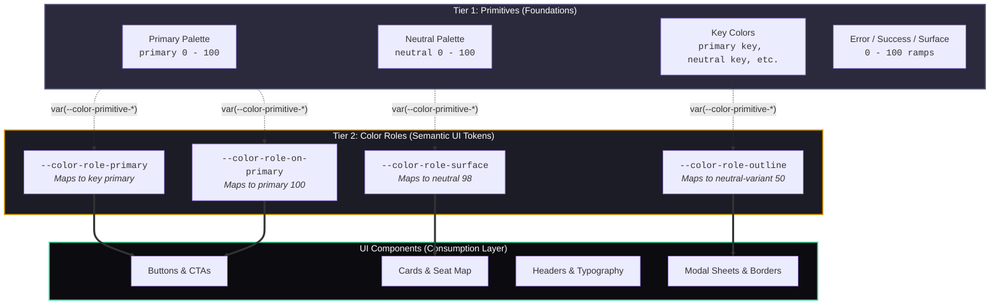

# Lead Row Design System - Token Architecture & CSS Variable Guide

This document establishes the official specifications and implementation guidelines for the **Lead Row Design System**, derived directly from the Figma design tokens (`design-tokens.tokens.json`).

---

## 1. Architectural Philosophy: The Two-Tier Color System

The Lead Row color system adheres to a strict **two-tier abstraction model** (aligned with Material Design 3 and DTCG Design Token Community Group standards).



### 1.1 Tier 1: Primitive Colors (Foundations)
- **Token Prefix:** `--color-primitive-*`
- **Definition:** The mathematical tonal ramps (0 to 100) and raw branding hues (e.g., Primary, Secondary, Tertiary, Neutral, Neutral-Variant, Error, Success, and Surface-Raised).
- **Core Characteristic:** Primitives have **no semantic intent**. A value like `--color-primitive-primary-40` simply denotes a specific shade of golden-amber.

> [!CAUTION]
> ### STRICT ARCHITECTURAL RULE: DO NOT USE PRIMITIVES ON UI
> Components, views, buttons, and styles **must never directly consume `--color-primitive-*` variables**.
> 
> Direct usage of primitives breaks theming, breaks contrast compliance, tightly couples components to arbitrary hex values, and prevents effortless dark-mode or white-label styling.

### 1.2 Tier 2: Color Roles (Semantic UI Application)
- **Token Prefix:** `--color-role-*` (with shorthand alias `--color-*`)
- **Definition:** Meaningful, purpose-driven tokens that declare **how** a color behaves in the interface (e.g., `primary`, `on-primary`, `surface`, `on-surface`, `outline`, `error`).
- **Core Characteristic:** Each color role maps directly to a primitive variable using CSS references:
  ```css
  --color-role-primary: var(--color-primitive-key-primary, #d7960a);
  --color-role-on-primary: var(--color-primitive-primary-100, #ffffff);
  --color-role-surface: var(--color-primitive-neutral-98, #f9f9fb);
  ```

> [!IMPORTANT]
> ### THE GOLDEN RULE OF UI THEMING
> **All UI styling MUST consume Color Roles (`--color-role-*` or `--color-*`).**
> When a component needs a background, it queries `var(--color-surface)` or `var(--color-primary-container)`. When it needs text, it queries the corresponding "on" role, such as `var(--color-on-surface)` or `var(--color-on-primary)`.

---

## 2. Token Converter Script (`convert-tokens.js`)

The project includes an automated, zero-dependency Node.js script that converts `design-tokens.tokens.json` into standards-compliant CSS custom properties.

### 2.1 Quick Start
Run the converter script directly via Node.js:

```bash
# Run with standard defaults (outputs to tokens.css)
node convert-tokens.js

# Custom input and output paths
node convert-tokens.js --input ./design-tokens.tokens.json --output ./tokens.css

# Output spacing in rem units instead of px
node convert-tokens.js --unit rem

# Display help and all available CLI flags
node convert-tokens.js --help
```

### 2.2 CLI Options & Flags

| Flag | Shorthand | Default | Description |
| :--- | :--- | :--- | :--- |
| `--input <path>` | `-i` | `design-tokens.tokens.json` | Path to source tokens JSON file |
| `--output <path>` | `-o` | `tokens.css` | Destination path for generated CSS |
| `--selector <str>` | `-s` | `:root` | CSS selector scope for the custom properties |
| `--unit <px\|rem>` | `-u` | `px` | Measurement unit for spacing dimensions |
| `--no-aliases` | | `false` | Disables convenience aliases like `--color-primary` |
| `--no-utilities` | | `false` | Omits the `.text-*` typography utility classes |
| `--raw-values` | | `false` | Inlines raw hex values instead of `var(--color-primitive-*)` |

### 2.3 Programmatic Usage (Node.js API)
You can also import the conversion engine into your build pipeline:

```javascript
const fs = require('fs');
const { convertDesignTokensToCSS } = require('./convert-tokens');

const rawTokens = JSON.parse(fs.readFileSync('design-tokens.tokens.json', 'utf8'));

const { css, metadata } = convertDesignTokensToCSS(rawTokens, {
  selector: ':root',
  spacingUnit: 'px',
  includeTypographyClasses: true
});

console.log(`Converted ${metadata.totalPrimitives} primitives and ${metadata.totalRoles} roles.`);
```

---

## 3. Color Roles Reference & Mapping

Below is the verified inventory of the primary semantic color roles generated by the script:

### 3.1 Primary Brand Roles
| CSS Variable | Convenience Alias | Target Primitive | Fallback Hex | Intended UI Application |
| :--- | :--- | :--- | :--- | :--- |
| `--color-role-primary` | `--color-primary` | `--color-primitive-key-primary` | `#d7960a` | Main call-to-action buttons, active navigation items, brand highlights |
| `--color-role-on-primary` | `--color-on-primary` | `--color-primitive-primary-100` | `#ffffff` | Text and icons displayed on top of `--color-primary` surfaces |
| `--color-role-primary-container` | `--color-primary-container` | `--color-primitive-primary-90` | `#fdeece` | Tonal badges, chip backgrounds, soft primary highlight panels |
| `--color-role-on-primary-container`| `--color-on-primary-container` | `--color-primitive-primary-30` | `#926607` | Text and icons placed on `--color-primary-container` |
| `--color-role-inverse-primary` | `--color-inverse-primary` | `--color-primitive-primary-80` | `#fadd9e` | Primary color elements when rendered against inverse surfaces |

### 3.2 Secondary & Tertiary Roles
| CSS Variable | Convenience Alias | Target Primitive | Fallback Hex | Intended UI Application |
| :--- | :--- | :--- | :--- | :--- |
| `--color-role-secondary` | `--color-secondary` | `--color-primitive-secondary-40` | `#c38809` | Secondary buttons, supportive filter tags, secondary icons |
| `--color-role-on-secondary` | `--color-on-secondary` | `--color-primitive-secondary-100` | `#ffffff` | Content and text on top of secondary elements |
| `--color-role-tertiary` | `--color-tertiary` | `--color-primitive-tertiary-40` | `#c38809` | Contrasting accents, promotional banners, special badges |
| `--color-role-on-tertiary` | `--color-on-tertiary` | `--color-primitive-tertiary-100` | `#ffffff` | Content placed over tertiary elements |

### 3.3 Surface, Container & Background Roles
| CSS Variable | Convenience Alias | Target Primitive | Fallback Hex | Intended UI Application |
| :--- | :--- | :--- | :--- | :--- |
| `--color-role-surface` | `--color-surface` | `--color-primitive-neutral-98` | `#f9f9fb` | Default page backgrounds and main card surfaces |
| `--color-role-on-surface` | `--color-on-surface` | `--color-primitive-neutral-10` | `#15151e` | High-emphasis body text, titles, and icons on surfaces |
| `--color-role-surface-variant` | `--color-surface-variant` | `--color-primitive-neutral-variant-90` | `#e3e3e8` | Card headers, dividers, subtle secondary containers |
| `--color-role-on-surface-variant`| `--color-on-surface-variant` | `--color-primitive-neutral-variant-30` | `#464653` | Medium-emphasis text, secondary labels, placeholders |
| `--color-role-surface-container` | `--color-surface-container` | `--color-primitive-neutral-90` | `#e1e1ea` | Elevated sheets, movie details cards, form groups |
| `--color-role-surface-container-high`| `--color-surface-container-high` | `--color-primitive-neutral-80` | `#c3c3d5` | Dropdowns, popovers, elevated modals |
| `--color-role-surface-container-highest`| `--color-surface-container-highest` | `--color-primitive-neutral-90` | `#e1e1ea` | Highest elevation surfaces in light mode |
| `--color-role-inverse-surface` | `--color-inverse-surface` | `--color-primitive-neutral-20` | `#2a2a3c` | Snackbars, dark tooltips, inverse contrast panels |
| `--color-role-inverse-on-surface`| `--color-inverse-on-surface`| `--color-primitive-neutral-95` | `#f0f0f5` | Text placed on top of inverse surfaces |

### 3.4 Outline & Feedback Roles
| CSS Variable | Convenience Alias | Target Primitive | Fallback Hex | Intended UI Application |
| :--- | :--- | :--- | :--- | :--- |
| `--color-role-outline` | `--color-outline` | `--color-primitive-neutral-variant-50` | `#75758a` | Form borders, card strokes, dividers, unselected seat borders |
| `--color-role-outline-variant` | `--color-outline-variant` | `--color-primitive-neutral-variant-80` | `#c8c8d0` | Low-contrast hairline dividers, subtle border strokes |
| `--color-role-error` | `--color-error` | `--color-primitive-error-40` | `#c90325` | Form validation errors, destructive actions, seat conflicts |
| `--color-role-on-error` | `--color-on-error` | `--color-primitive-error-100` | `#ffffff` | Text placed on top of error buttons and alerts |
| `--color-role-error-container` | `--color-error-container` | `--color-primitive-error-90` | `#fecdd5` | Error alert banners, warning backgrounds |

---

## 4. Spacing System Reference

The spacing scale is built upon an accessible **4pt/8pt rhythm**:

| Variable | T-Shirt Alias | Value (px) | Grid Step | Typical UI Usage |
| :--- | :--- | :--- | :--- | :--- |
| `--spacing-no` | `--spacing-no` | `0px` | 0 | Reset margins and padding |
| `--spacing-extra-extra-small` | `--spacing-xxs` | `2px` | 0.25x | Hairline gaps, badge offsets |
| `--spacing-extra-small` | `--spacing-xs` | `4px` | 0.5x | Icon-to-text spacing, compact tags |
| `--spacing-small` | `--spacing-sm` | `8px` | 1x | Button internal padding, chip spacing |
| `--spacing-medium` | `--spacing-md` | `10px` | 1.25x | Component gaps, list item padding |
| `--spacing-base` | `--spacing-base` | `16px` | 2x | Default screen padding, card body padding |
| `--spacing-large` | `--spacing-lg` | `20px` | 2.5x | Section gutters, modal spacing |
| `--spacing-extra-large` | `--spacing-xl` | `24px` | 3x | Major card gutters, layout padding |
| `--spacing-very-large` | `--spacing-2xl` | `32px` | 4x | Section breaks, hero margins |
| `--spacing-layout-spacing-1` | `--spacing-layout-1` | `48px` | 6x | Screen header padding, major layout gaps |
| `--spacing-layout-spacing-2` | `--spacing-layout-2` | `64px` | 8x | Footer margins, empty state spacing |

---

## 5. Elevation & Shadow Reference

Shadows provide visual hierarchy for floating elements and sheets:

| Variable | Value | Intended Usage |
| :--- | :--- | :--- |
| `--shadow-soft` | `2px 2px 20px 0px rgba(0, 0, 0, 0.12)` | Resting cards, movie poster tiles, interactive chips |
| `--shadow-medium` | `2px 4px 6px 0px rgba(0, 0, 0, 0.28)` | Hovered cards, floating action buttons, sticky headers |
| `--shadow-hard` | `4px 2px 8px 0px rgba(0, 0, 0, 0.32)` | Modals, bottom booking summary sheet, dialog overlays |

---

## 6. Typography Scale Reference

Lead Row pairs **Playfair Display** (for editorial, cinematic luxury titles) with **Inter** (for high-legibility UI text):

| Style Key | Font Family | Size | Line Height | Weight | Letter Spacing | CSS Shorthand Variable |
| :--- | :--- | :--- | :--- | :--- | :--- | :--- |
| `display-large` | Playfair Display | `57px` | `85.5px` | 500 | `-0.143px` | `--typography-display-large` |
| `display-medium` | Playfair Display | `45px` | `67.5px` | 500 | `normal` | `--typography-display-medium` |
| `display-small` | Playfair Display | `36px` | `54px` | 400 | `normal` | `--typography-display-small` |
| `headline-large` | Inter | `32px` | `48px` | 400 | `normal` | `--typography-headline-large` |
| `headline-medium`| Inter | `28px` | `42px` | 400 | `normal` | `--typography-headline-medium` |
| `headline-small` | Inter | `24px` | `36px` | 400 | `normal` | `--typography-headline-small` |
| `title-large` | Inter | `22px` | `33px` | 400 | `normal` | `--typography-title-large` |
| `title-medium` | Inter | `16px` | `24px` | 500 | `0.024px` | `--typography-title-medium` |
| `title-small` | Inter | `14px` | `21px` | 500 | `0.014px` | `--typography-title-small` |
| `body-large` | Inter | `16px` | `24px` | 500 | `0.08px` | `--typography-body-large` |
| `body-medium` | Inter | `14px` | `21px` | 500 | `0.035px` | `--typography-body-medium` |
| `body-small` | Inter | `12px` | `18px` | 500 | `0.048px` | `--typography-body-small` |
| `label-large` | Inter | `14px` | `21px` | 500 | `0.014px` | `--typography-label-large` |
| `label-medium` | Inter | `12px` | `18px` | 500 | `-0.9px` | `--typography-label-medium` |
| `label-small` | Inter | `10px` | `15px` | 500 | `-0.8px` | `--typography-label-small` |

---

## 7. Practical Component Implementation Examples

### 7.1 Primary Action Button (e.g., "Select Seats" / "Pay Now")
```css
/* ✅ CORRECT: Uses Color Roles, Spacing Tokens, and Typography Tokens */
.btn-primary {
  display: inline-flex;
  align-items: center;
  justify-content: center;
  gap: var(--spacing-sm);
  padding: var(--spacing-sm) var(--spacing-base);
  background-color: var(--color-role-primary);
  color: var(--color-role-on-primary);
  border: 1px solid transparent;
  border-radius: var(--spacing-sm);
  font: var(--typography-label-large);
  box-shadow: var(--shadow-soft);
  cursor: pointer;
  transition: background-color 0.2s ease, box-shadow 0.2s ease;
}

.btn-primary:hover {
  background-color: var(--color-role-secondary);
  box-shadow: var(--shadow-medium);
}

/* ❌ INCORRECT: Directly references a primitive value */
.btn-bad {
  background-color: var(--color-primitive-primary-40); /* PROHIBITED */
}
```

### 7.2 Movie Showcard / Seat Selection Card
```css
.movie-card {
  background-color: var(--color-role-surface);
  color: var(--color-role-on-surface);
  border: 1px solid var(--color-role-outline-variant);
  border-radius: var(--spacing-md);
  padding: var(--spacing-base);
  box-shadow: var(--shadow-soft);
}

.movie-card__title {
  font: var(--typography-title-large);
  color: var(--color-role-on-surface);
  margin-bottom: var(--spacing-xs);
}

.movie-card__genre {
  font: var(--typography-body-small);
  color: var(--color-role-on-surface-variant);
}
```

### 7.3 Bottom Booking Sheet
```css
.booking-bottom-sheet {
  background-color: var(--color-role-surface-container);
  color: var(--color-role-on-surface);
  padding: var(--spacing-xl);
  border-top-left-radius: var(--spacing-xl);
  border-top-right-radius: var(--spacing-xl);
  box-shadow: var(--shadow-hard);
}
```

---

## 8. Mobile & React Native Integration Notes

In `apps/mobile/`, tokens can be consumed seamlessly in Expo/React Native in either of two ways:

1. **NativeWind / Tailwind CSS:** The CSS variables in `tokens.css` can be referenced directly in `tailwind.config.js`:
   ```javascript
   // tailwind.config.js
   module.exports = {
     theme: {
       extend: {
         colors: {
           primary: 'var(--color-role-primary)',
           surface: 'var(--color-role-surface)',
           outline: 'var(--color-role-outline)',
         }
       }
     }
   };
   ```

2. **JavaScript Token Theme Object:**
   The `convert-tokens.js` module can export clean JavaScript objects mapping directly to React Native `StyleSheet` themes without manual re-keying.

