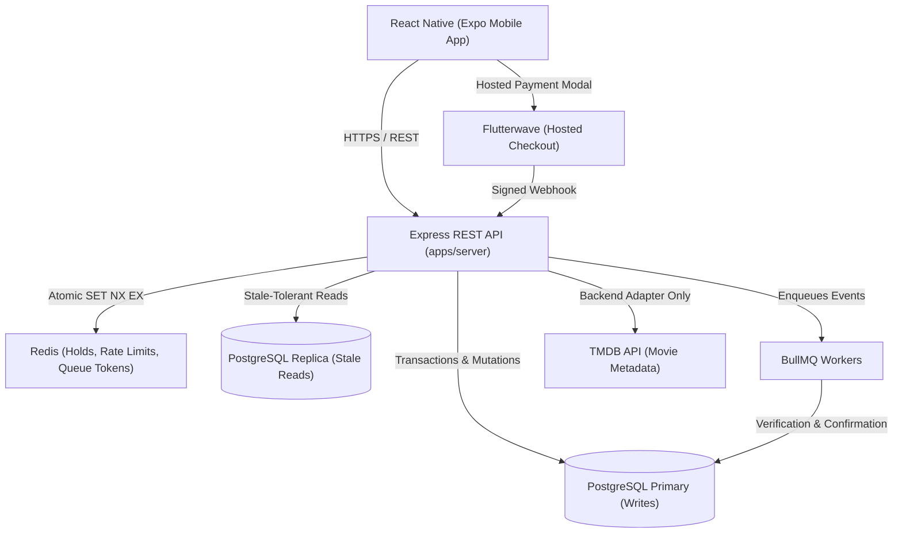

# Lead Row - System Architecture Specification

## 1. Executive Overview

Lead Row is built to guarantee that **one cinema seat can have at most one confirmed booking for a given showtime** under heavy concurrent load, while delivering a fluid, accessible mobile experience.

---

## 2. Component Boundaries & Topologies

---

## 3. Database Topology & Routing Boundary

- **Primary Write Routing:** All mutating operations (hold creations, checkouts, webhook booking confirmations) and consistency-sensitive reads (checking seat availability right after a hold) are routed strictly to the PostgreSQL primary database.
- **Replica Read Routing:** Catalogue browsing and movie list endpoints query the read replica.
- **Single-Node / Free-Tier Hosting Dispensation:** If hosted on a free-tier provider without a read replica, the repository layer maintains the explicit `writeClient` and `readClient` interface, both pointing to the primary database URL.

---

## 4. Double-Booking Prevention: The Two-Phase Gate

1. **Phase 1 (Redis Fast Gate):** 10-minute atomic hold (`SET NX EX 600`) evaluated using an atomic Lua script for multi-seat requests.
2. **Phase 2 (PostgreSQL Durable Safety Net):** Confirmed allocations require a database transaction enforcing a partial unique index on `booking_seats (showtime_id, seat_id) WHERE status = 'CONFIRMED'`.

