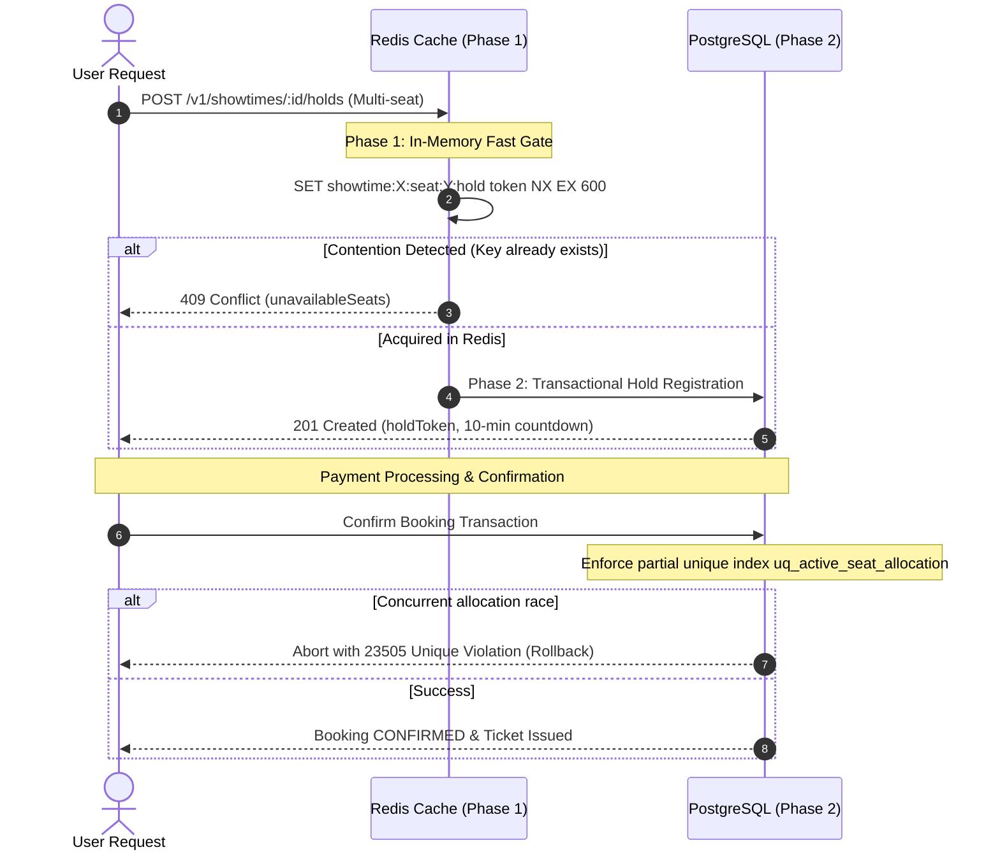

# Lead Row - System Architecture Specification

## 1. Executive Overview

Lead Row is built to guarantee that **one cinema seat can have at most one confirmed booking for a given showtime** under heavy concurrent load, while delivering a fluid, accessible mobile experience.

---

## 2. Component Boundaries & Topologies

```mermaid
graph TD
    Client["React Native (Expo Mobile App)"]
    API["Express REST API (Vercel Serverless / Render Container)"]
    Redis["Redis Cloud (Holds, Rate Limits, Queue Tokens)"]
    DB_Primary[("Neon PostgreSQL Primary (Writes)")]
    DB_Replica[("Neon PostgreSQL Replica (Stale Reads)")]
    BullMQ["BullMQ Workers (Webhooks, Reconciliation, Refunds)"]
    TMDB["TMDB API (Movie Metadata Gateway)"]
    FLW["Flutterwave (Hosted Checkout Sandbox)"]

    Client -->|HTTPS / REST| API
    API -->|Atomic SET NX EX| Redis
    API -->|Transactions & Mutations| DB_Primary
    API -->|Stale-Tolerant Reads| DB_Replica
    API -->|Enqueues Events| BullMQ
    API -->|Backend Adapter Only| TMDB
    Client -->|Hosted Payment Modal| FLW
    FLW -->|Signed Webhook (verif-hash)| API
    BullMQ -->|Verification & Confirmation| DB_Primary
```

---

## 3. Database Topology, Routing Boundary & Connection Pooling

- **Primary Write Routing:** All mutating operations (hold creations, checkouts, webhook booking confirmations) and consistency-sensitive reads (checking seat availability right after a hold) are routed strictly to the PostgreSQL primary database (`writeClient`).
- **Replica Read Routing:** Catalogue browsing and movie list endpoints query the read replica (`readClient`).
- **Single-Node / Free-Tier Hosting Dispensation:** When hosted on serverless Neon free tier without a dedicated replica pool, the repository layer maintains the explicit `writeClient` and `readClient` architectural boundary, both safely bound to the primary pool.
- **Connection Pool Configuration:** Prisma client pools are sized via connection string parameters (`connection_limit=20`, `pool_timeout=10s`) to prevent connection starvation and process thrashing during traffic spikes.

---

## 4. Double-Booking Prevention: The Two-Phase Gate



1. **Phase 1 (Redis Fast Gate):** 10-minute atomic hold (`SET NX EX 600`) evaluated using an atomic multi-seat loop with owner-token compensating rollbacks. Absorbs 95% of rejected contention in RAM.
2. **Phase 2 (PostgreSQL Durable Safety Net):** Confirmed allocations require a database transaction enforcing a partial unique index on `booking_seats (showtime_id, seat_id) WHERE status = 'CONFIRMED'`.

---

## 5. Authoritative Financial Lifecycle & Payment Correctness

1. **Strict Minor-Unit Arithmetic:** All currency is stored as integer NGN kobo ($1\text{ NGN} = 100\text{ kobo}$). Floating-point arithmetic is prohibited across all billing boundaries.
2. **Authoritative Calculation:** Subtotal, authoritative ₦500 service fee, and total are calculated exclusively on the server during checkout initialization (`POST /v1/bookings/checkout`).
3. **Idempotency Guarantees:** Checkouts require a client-supplied `idempotencyKey` enforcing single-order creation in PostgreSQL.
4. **Webhook Verification:** Inbound payment notifications verify the `verif-hash` header against HMAC secrets, record the event in `webhook_events`, and process idempotently via BullMQ.
5. **Append-Only Financial Ledger:** Every transaction logs immutable entries (`PAYMENT_RECEIVED`, `REFUND_ISSUED`) to `ledger_entries` with unique provider references.

---

## 6. Observability & Error Tracking

- **Request ID Middleware:** A unique UUID v4 is stamped onto every HTTP request via `X-Request-Id` and propagated across Winston structured logs, database queries, and background jobs.
- **Error Tracker Adapter:** An extensible error tracking adapter (`errorTracker.ts`) captures unhandled exceptions with request context, ready for Sentry/Datadog integration.

